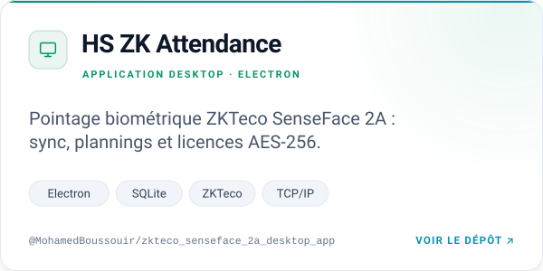
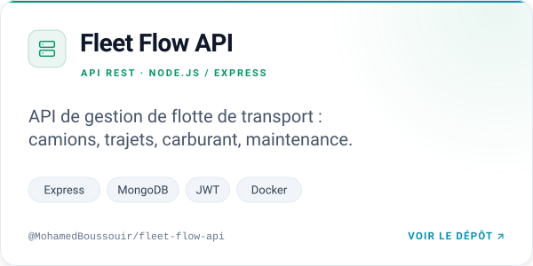
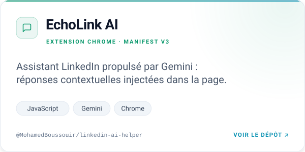
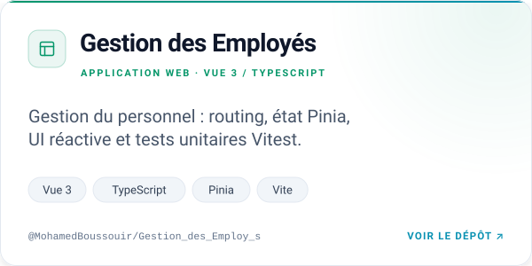

  <picture>
    <source media="(prefers-color-scheme: dark)" srcset="assets/banner-dark.svg">
    <source media="(prefers-color-scheme: light)" srcset="assets/banner-light.svg">
    
  </picture>

  
  
  
  

## Salut 👋

Je suis **Mohammed**, développeur **full stack** en formation chez **YouCode – UM6P** (Campus Youssoufia). J'aime construire des produits complets : une interface soignée, une API solide, un déploiement propre — et comprendre ce qui se passe sous le capot.

Mon stage chez **Ouahda Solutions** m'a fait passer du code au terrain : j'y ai conçu **trois applications de pointage biométrique** (Electron + Laravel) déployées chez des clients réels, avec leurs protocoles ZKTeco, leur synchronisation et leurs licences chiffrées.

- 🎯 **Objectif** : un premier poste (ou un stage) en développement full stack — Maroc ou remote.
- 🧠 **Ce que j'aime** : les problèmes concrets — protocoles réseau, synchronisation de données, performance.
- 🧰 **Mon terrain de jeu** : React · Node · Laravel · Electron · Docker.

## 🛠️ Stack technique

<b>FRONTEND</b>

  
  
  
  
  
  

<b>BACKEND</b>

  
  
  
  
  
  

<b>BASES DE DONNÉES</b>

  
  
  
  

<b>OUTILS &amp; DEVOPS</b>

  
  
  
  
  
  

<b>DESIGN &amp; MÉTHODES</b>

  
  
  
  
  
  

## 🚀 Projets à la une

  <a href="https://github.com/MohamedBoussouir/zkteco_senseface_2a_desktop_app">
    <picture>
      <source media="(prefers-color-scheme: dark)" srcset="assets/cards/zk-dark.svg">
      <source media="(prefers-color-scheme: light)" srcset="assets/cards/zk-light.svg">
      
    </picture>
  </a>
  <a href="https://github.com/MohamedBoussouir/fleet-flow-api">
    <picture>
      <source media="(prefers-color-scheme: dark)" srcset="assets/cards/fleet-dark.svg">
      <source media="(prefers-color-scheme: light)" srcset="assets/cards/fleet-light.svg">
      
    </picture>
  </a>

  <a href="https://github.com/MohamedBoussouir/linkedin-ai-helper">
    <picture>
      <source media="(prefers-color-scheme: dark)" srcset="assets/cards/echo-dark.svg">
      <source media="(prefers-color-scheme: light)" srcset="assets/cards/echo-light.svg">
      
    </picture>
  </a>
  <a href="https://github.com/MohamedBoussouir/Gestion_des_Employ_s">
    <picture>
      <source media="(prefers-color-scheme: dark)" srcset="assets/cards/rh-dark.svg">
      <source media="(prefers-color-scheme: light)" srcset="assets/cards/rh-light.svg">
      
    </picture>
  </a>

<b>Et quelques autres projets…</b>

 

| Projet | En deux mots | Stack |
| :-- | :-- | :-- |
| **[SportConnect&nbsp;Pro](https://github.com/MohamedBoussouir/SportConnect_Pro)** | Plateforme web sportive : profils, annonces et tableau de bord | `Express` `EJS` `PostgreSQL` |
| **[PayFlow](https://github.com/MohamedBoussouir/PayFlow_api)** | API de paiement avec authentification par token | `Laravel 12` `Sanctum` `MySQL` |
| **[E-commerce&nbsp;MVC](https://github.com/MohamedBoussouir/application_web_e_commerce_MVC)** | Boutique en ligne en PHP MVC, sans framework | `PHP` `MySQL` |
| **[TeamUp.gg](https://github.com/MohamedBoussouir/TeamUp.gg)** | Trouver des coéquipiers et des annonces e-sport | `HTML` `CSS` `JavaScript` |
| **[Jeu de réflexes](https://github.com/MohamedBoussouir/Application-Web-de-R-flexes-et-Pr-cision)** | Mini-jeu web pour mesurer temps de réaction et précision | `JavaScript` |

## 💼 Expérience

**Développeur Full Stack — Stagiaire** · **Ouahda Solutions** · Dakhla, Maroc 
Mai 2026 – Juillet 2026

- **3 applications** de gestion de présence biométrique pour terminaux **ZKTeco SenseFace 2A** : 2 desktop **Electron.js** (mode TCP/IP direct et mode ADMS) et 1 plateforme web **Laravel** — déployées chez des clients réels.
- Implémentation des protocoles **ZK TCP/IP** et **ADMS** : serveur HTTP embarqué, handshake, file de commandes asynchrones avec accusés (ACK), verrouillage par IP, timeouts et compatibilité multi-firmware.
- **Synchronisation** employés / empreintes / pointages, gestion des plannings (shifts, work patterns, monthly patterns) et génération automatique des rotations.
- **Sécurité & delivery** : licences **AES-256-GCM**, obfuscation du code, **Docker** (Laravel + MySQL + Nginx), rapports **PDF / Excel**, interface multilingue **AR / FR / EN**.
- Modélisation **UML** (cas d'utilisation, classes) et travail itératif en **Git / GitHub** avec revues régulières.

## 🎓 Formation & certifications

**Développeur Full Stack (MERN)** — YouCode · UM6P, Campus Youssoufia 
2025 – aujourd'hui

**Baccalauréat Sciences Physiques** — Lycée El Fath, Dakhla 
2020 – 2021

**Compétences transversales & anglais** — Amideast Maroc 
2025 – aujourd'hui · communication professionnelle, prise de parole en public, apprentissage par projets

## 📬 Me contacter

  
  

  Ouvert aux opportunités · Agadir, Maroc

